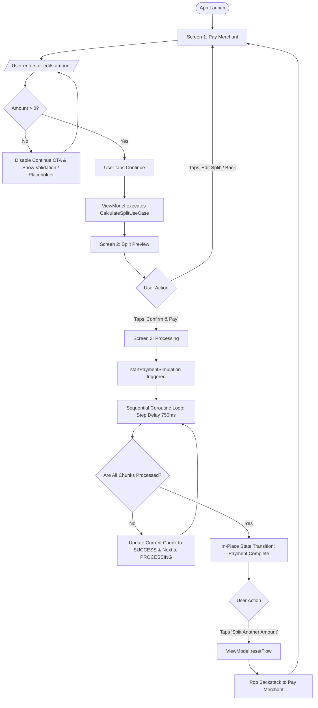

# SplitPay Android — Application Flow & User Journey

This document details the end-to-end user journey across the SplitPay Android prototype, explaining screen transitions, user interactions, internal state triggers, and navigation dynamics.

---

## Complete Journey Flowchart



---

## Detailed Step-by-Step Flow

### 1. App Launch & Screen 1: Pay Merchant
- **Start Route:** `pay_merchant`.
- **Default State:** Pre-populated with default amount `₹10,000`, verified merchant `"The Coffee House"` (`coffeehouse@upi`), and Smart Pay enabled.
- **Interactions:**
  - The amount is editable via `BasicTextField`. Input is filtered to digits only (`value.filter { it.isDigit() }.take(10)`), completely preventing invalid characters or `Long` overflow.
  - When the field is cleared, an inline placeholder `"0"` is displayed with min-width padding so tap focus remains natural and comfortable.
  - The Smart Pay toggle switch allows turning splitting on or off.
  - An MDR informational card explains merchant benefits for splitting amounts exceeding ₹2,000.
  - The **Continue** button remains active if `parsedAmount > 0L`. If the input is zero or blank, the button disables immediately.

### 2. Continue Action & Split Calculation
- When the user taps **Continue**, `viewModel.calculateSplit()` runs synchronously:
  - Invokes `CalculateSplitUseCase(parsedAmount)`.
  - Amounts $\le$ ₹1,999 produce 1 chunk.
  - Amounts > ₹1,999 produce $N$ chunks of ₹1,999 plus 1 remainder chunk (if remainder > 0).
  - Navigation fires: `navController.navigate("split_preview")`.

### 3. Screen 2: Smart Pay / Split Preview
- **Route:** `split_preview`.
- **Visual Presentation:**
  - Header summary displaying the recipient merchant and total amount.
  - Split breakdown card listing each individual sub-transaction chunk with an indexed sequence pill (e.g., `"Split 1 of 6"`, `"₹1,999"`).
  - An order summary card displaying the total item count and payment sum (`"You pay ₹10,000"`).
  - Security reassurance note: *"All payments will be made securely via UPI. This usually takes a few seconds."*
- **Actions:**
  - **Edit Split / Back Arrow:** Calls `navController.popBackStack()`, returning to Screen 1 with the user's previous amount preserved.
  - **Confirm & Pay:** Navigates to `processing` (`Screen.Processing.route`).

### 4. Screen 3: Processing & Real-Time Tracking
- **Route:** `processing`.
- **Simulation Launch:**
  - Upon entering Screen 3, `viewModel.startPaymentSimulation()` executes.
  - State guard ensures duplicate clicks or navigation reentry cannot start concurrent simulation jobs:
    ```kotlin
    if (_uiState.value.isProcessingActive || _uiState.value.isPaymentCompleted) return
    ```
  - Chunk 0 immediately transitions from `PENDING` to `PROCESSING`. Remaining chunks are set to `PENDING`.
- **Visual Dynamics:**
  - **Dark Radar Header:** Background `#0F172A`, outer rotating sweep arc in glowing green (`#22C55E`), central emerald core (`#059669`) with tilted paper plane icon (`-15°`), and pulsating radar glow rings.
  - **Linear Progress Bar:** Dynamically tracks percentage completion (`Completed X of Y chunks (Z%)`).
  - **Breakdown Sheet:** White curved sheet displaying real-time `LiveChunkStepRow` components:
    - `PROCESSING`: Animated circular spinner with `"Processing..."` and `"ACTIVE"` badge.
    - `SUCCESS`: Solid emerald check icon, formatted completion timestamp (e.g., `"Completed • 11:30 PM"`), and `"PAID"` badge.
    - `PENDING`: Outline circle with inner dot, `"Waiting in queue"`, and `"QUEUED"` badge.
  - **Security Advisory:** Slate card reminding the user that transactions are processed sequentially and not to close the app.

### 5. In-Place State Transition: Payment Complete
- **No Route Change:** Screen 3 does NOT navigate to a fourth screen.
- When the final chunk succeeds:
  - `isProcessingActive` is updated to `false`.
  - `isPaymentCompleted` is set to `true`.
  - The radar header changes to a static green checkmark disc with the badge `"ALL CHUNKS PROCESSED"`.
  - The progress bar reaches 100%.
  - The processing security notice is replaced by the mint confirmation banner:
    > *"Simulation complete — no real payment was made."*
  - The bottom primary CTA button **"Split Another Amount"** appears.

### 6. Reset & New Transaction
- Tapping **"Split Another Amount"** triggers:
  1. `viewModel.resetFlow()`:
     - Cancels active coroutine jobs.
     - Resets state back to default `10000` / 6 pending chunks.
  2. Single-stack navigation:
     ```kotlin
     navController.navigate(Screen.PayMerchant.route) {
         popUpTo(Screen.PayMerchant.route) { inclusive = true }
     }
     ```
  3. Pops all intermediate destinations off the backstack, returning the user cleanly to Screen 1.
  4. The user can immediately enter a new amount and start a subsequent simulation without app restart.

---

## Navigation Architecture Table

| Screen Name | Route Constant | Navigation Route | Primary Purpose | Primary Actions | Destination State |
| :--- | :--- | :--- | :--- | :--- | :--- |
| **Pay Merchant** | `Screen.PayMerchant.route` | `pay_merchant` | Enter & validate transaction amount | Edit amount, toggle Smart Pay, tap Continue | `split_preview` |
| **Split Preview** | `Screen.SplitPreview.route` | `split_preview` | Review calculated chunk breakdown | Back / Edit Split, Confirm & Pay | `pay_merchant` (back) or `processing` |
| **Processing** | `Screen.Processing.route` | `processing` | Track live sequential simulated payment chunks | Observes automated coroutine step transitions | **Payment Complete** *(in-place UI state)* |

> [!NOTE]
> **Strict Route Invariance:** The application maintains exactly **3 navigation routes**. Payment completion is an in-place visual transition within `processing` driven by `SplitPayUiState.isPaymentCompleted`.
