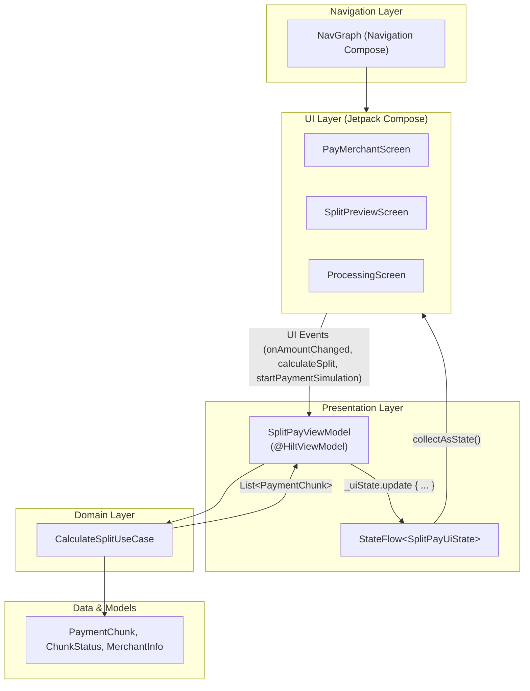

# SplitPay Android — Application Architecture & Engineering Design

This document details the software architecture, dependency injection, reactive state propagation, and package organization of the SplitPay Android prototype.

---

## Architectural Philosophy

SplitPay is built following **Clean Architecture** principles and Android Modern Architecture guidelines:
- **Unidirectional Data Flow (UDF):** User actions flow upwards as events into the ViewModel; state flows downwards as immutable data classes consumed by Jetpack Compose.
- **Single Source of Truth:** `SplitPayViewModel` maintains a single `MutableStateFlow<SplitPayUiState>` that coordinates all 3 screens.
- **Separation of Concerns:** Business rules (chunk splitting) are isolated in a domain use case, decoupled from Android frameworks and UI lifecycles.
- **Dependency Injection:** Dagger Hilt automates constructor injection and manages ViewModel lifecycle.

---

## High-Level Architecture Flowchart



---

## Package Structure

```text
com.splitpay.app
├── MainActivity.kt                      # Single activity entry point with Edge-to-Edge support
├── SplitPayApplication.kt               # Application class annotated with @HiltAndroidApp
├── data
│   └── model
│       ├── ChunkStatus.kt              # Enum: PENDING, PROCESSING, SUCCESS
│       ├── MerchantInfo.kt             # Data class: Merchant details & verification badge
│       └── PaymentChunk.kt             # Data class: Chunk index, amount, status, timestamp
├── domain
│   └── usecase
│       └── CalculateSplitUseCase.kt    # Core business logic: splits Long amount into <= ₹1,999 chunks
├── presentation
│   ├── navigation
│   │   ├── NavGraph.kt                 # NavHost configuring exactly 3 destinations
│   │   └── Screen.kt                   # Sealed class defining routes (pay_merchant, split_preview, processing)
│   ├── screens
│   │   ├── PayMerchantScreen.kt        # Screen 1: Amount input, Smart Pay toggle, MDR note
│   │   ├── SplitPreviewScreen.kt       # Screen 2: Chunks breakdown, order summary, Confirm CTA
│   │   └── ProcessingScreen.kt         # Screen 3: Dark radar header, live chunk tracking, completion
│   └── viewmodel
│       ├── SplitPayUiState.kt          # Immutable state model driving all screens
│       └── SplitPayViewModel.kt        # Hilt ViewModel coordinating logic, state, and simulation
├── ui
│   └── theme
│       ├── Color.kt                    # Kinetic Ledger palette (Slate, Emerald, Mint tokens)
│       ├── Theme.kt                    # SplitPay Material 3 theme wrapper
│       └── Type.kt                     # Typography configuration
└── util
    └── CurrencyFormatter.kt            # Indian numbering format utility (₹1,00,000)
```

---

## Component Responsibilities

| File / Component | Layer | Primary Responsibility |
| :--- | :--- | :--- |
| **`MainActivity`** | Presentation | Host activity configured with `@AndroidEntryPoint` and `enableEdgeToEdge()`. Holds the single `viewModels()` instance and sets Compose content. |
| **`SplitPayApplication`** | Application | Root Application class with `@HiltAndroidApp` initializing Dagger Hilt dependency graph. |
| **`CalculateSplitUseCase`** | Domain | Pure Kotlin business logic. Computes chunk partitions ensuring every chunk $\le$ ₹1,999 and total equals original amount. Zero UI or Android framework dependencies. |
| **`SplitPayViewModel`** | Presentation | Bridges UI and Domain layers. Manages `SplitPayUiState`, handles amount sanitization, coordinates chunk calculation, and executes sequential payment simulation coroutines. |
| **`SplitPayUiState`** | Presentation | Single immutable data container representing current application state across all three screens. |
| **`NavGraph` & `Screen`** | Navigation | Jetpack Navigation Compose setup binding routes (`pay_merchant`, `split_preview`, `processing`) to Composable screens with single-top backstack handling. |
| **`PayMerchantScreen`** | UI | Screen 1 UI. Manages merchant header, amount input text field, Smart Pay switch, and Continue button state. |
| **`SplitPreviewScreen`** | UI | Screen 2 UI. Displays list of calculated payment chunks, total summary card, security disclaimer, and Confirm & Pay action. |
| **`ProcessingScreen`** | UI | Screen 3 UI. Renders animated radar sweeps, real-time chunk status rows, dynamic progress counter, and in-place completion banner. |
| **`CurrencyFormatter`** | Utility | Formats `Long` values into Indian numbering syntax (e.g. `100000` $\rightarrow$ `"₹1,00,000"`). |

---

## Dependency Injection (Hilt Setup)

Dagger Hilt provides clean, compile-time dependency injection:
1. **Application Level:** `SplitPayApplication` annotated with `@HiltAndroidApp`.
2. **Activity Level:** `MainActivity` annotated with `@AndroidEntryPoint`.
3. **ViewModel Level:** `SplitPayViewModel` annotated with `@HiltViewModel`, injecting `CalculateSplitUseCase`:
   ```kotlin
   @HiltViewModel
   class SplitPayViewModel @Inject constructor(
       private val calculateSplitUseCase: CalculateSplitUseCase
   ) : ViewModel()
   ```
4. **Use Case Level:** `CalculateSplitUseCase` constructor annotated with `@Inject constructor()`.

---

## State Flow & Shared ViewModel Pattern

Rather than fragmenting state across multiple ViewModels or passing transient bundle arguments via Navigation Compose, SplitPay uses a **shared ViewModel scoped to the Activity lifecycle**:

```kotlin
// In MainActivity.kt
private val viewModel: SplitPayViewModel by viewModels()

// In NavGraph.kt
NavGraph(navController = navController, viewModel = viewModel)
```

### Advantages of Shared ViewModel for this Flow:
1. **Zero Data Loss on Back Navigation:** When the user taps *"Edit Split"* on Screen 2, popping back to Screen 1 preserves their entered amount, notes, and toggles without complex saved state restoration.
2. **Seamless Navigation Hand-off:** Screen 1 computes chunks directly into `_uiState.calculatedChunks`; Screen 2 and Screen 3 immediately read the active chunk list without serialization or parceling overhead.
3. **Atomic Reset:** Tapping *"Split Another Amount"* invokes `viewModel.resetFlow()`, updating the single state flow and guaranteeing that all screens reset synchronously.
