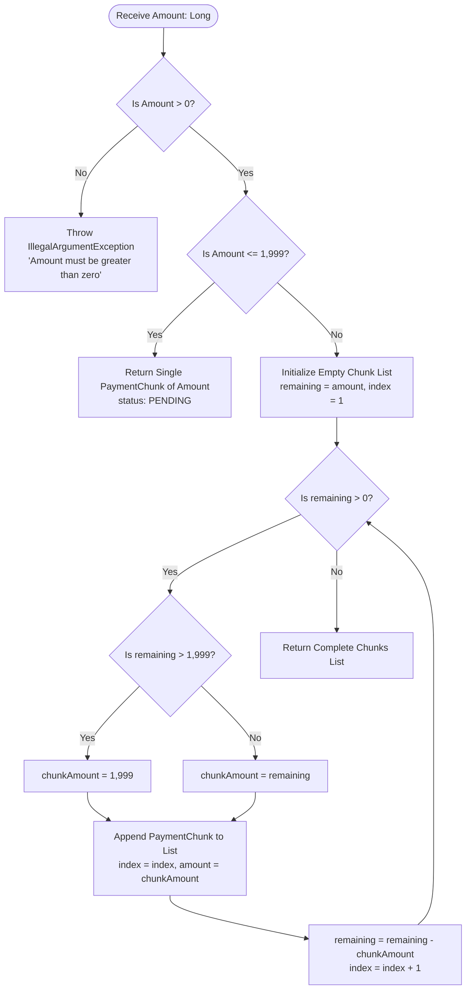

# SplitPay Android — Business Logic & Validation Engine

This document outlines the core business logic, mathematical partitioning algorithm, validation rules, currency representation, and edge case handling implemented in SplitPay.

---

## The ₹1,999 Threshold Business Rule

Under prevailing retail UPI merchant fee guidelines in India, transactions above ₹2,000 may attract Merchant Discount Rate (MDR) interchange fees. SplitPay eliminates this friction by ensuring that no individual transaction chunk exceeds **₹1,999**:

- **Maximum Chunk Limit (`MAX_CHUNK_LIMIT`):** `1_999L` (₹1,999)
- **Amount $\le$ ₹1,999:** Transaction is NOT split. A single chunk of the original amount is returned.
- **Amount > ₹1,999:** The amount is partitioned into $N$ equal chunks of ₹1,999 plus a single remainder chunk containing the residual amount (if remainder $> 0$).

---

## Split Algorithm Flowchart



---

## Implementation Reference (`CalculateSplitUseCase.kt`)

```kotlin
class CalculateSplitUseCase @Inject constructor() {

    companion object {
        const val MAX_CHUNK_LIMIT: Long = 1_999L
    }

    operator fun invoke(amount: Long): List<PaymentChunk> {
        require(amount > 0L) { "Amount must be greater than zero" }

        if (amount <= MAX_CHUNK_LIMIT) {
            return listOf(
                PaymentChunk(index = 1, amount = amount, status = ChunkStatus.PENDING)
            )
        }

        val chunks = mutableListOf<PaymentChunk>()
        var remainingAmount = amount
        var currentIndex = 1

        while (remainingAmount > 0L) {
            val chunkAmount = if (remainingAmount > MAX_CHUNK_LIMIT) MAX_CHUNK_LIMIT else remainingAmount
            chunks.add(
                PaymentChunk(
                    index = currentIndex,
                    amount = chunkAmount,
                    status = ChunkStatus.PENDING
                )
            )
            remainingAmount -= chunkAmount
            currentIndex++
        }

        return chunks
    }
}
```

---

## Split Calculation Examples

The table below demonstrates the exact output of `CalculateSplitUseCase` across key test vectors:

| Input Amount | Mathematical Breakdown | Total Chunks | Generated Chunk Amounts (₹) | Sum Verified |
|---:|:---|:---:|:---|:---:|
| **₹1,500** | $1,500 \le 1,999$ | 1 | `[1500]` | ₹1,500 |
| **₹1,999** | $1,999 \le 1,999$ | 1 | `[1999]` | ₹1,999 |
| **₹2,000** | $1,999 \times 1 + 1$ | 2 | `[1999, 1]` | ₹2,000 |
| **₹2,001** | $1,999 \times 1 + 2$ | 2 | `[1999, 2]` | ₹2,001 |
| **₹4,000** | $1,999 \times 2 + 2$ | 3 | `[1999, 1999, 2]` | ₹4,000 |
| **₹10,000** | $1,999 \times 5 + 5$ | 6 | `[1999, 1999, 1999, 1999, 1999, 5]` | ₹10,000 |

### Mathematical Invariants Guaranteed
1. $\forall c \in \text{chunks}, \quad 0 < c.\text{amount} \le 1,999$
2. $\sum_{i=1}^{N} c_i.\text{amount} = \text{originalAmount}$
3. $\text{chunk count } N = \lceil \text{amount} / 1999 \rceil$

---

## Financial Representation: Why `Long` is Used

In SplitPay, all monetary values are strictly typed as `Long` integers representing whole rupees:
- **Zero Floating-Point Inaccuracies:** Binary floating-point types (`Float` or `Double`) suffer from IEEE-754 rounding artifacts (e.g. `0.1 + 0.2 = 0.30000000000000004`). In financial systems, accumulating rounding errors can cause partition mismatches where $\sum c_i \neq \text{total}$.
- **Overflow Immunity:** Kotlin's 64-bit signed `Long` supports values up to $9 \times 10^{18}$, far exceeding reasonable currency limits while completely protecting against 32-bit integer overflow (`2,147,483,647`).
- **Input Sanitization:** The user's input string is filtered:
  ```kotlin
  val cleanValue = value.filter { it.isDigit() }.take(10)
  val parsed = cleanValue.toLongOrNull() ?: 0L
  ```
  Capping input length at 10 digits ensures that even large inputs (up to ₹999+ crore) parse safely without exception or overflow.

---

## Currency Formatting Engine (`CurrencyFormatter.kt`)

SplitPay implements custom Indian Numbering System formatting rules (2,2,3 grouping) rather than Western 3,3,3 grouping:

```kotlin
object CurrencyFormatter {
    fun formatIndianNumber(amount: Long): String {
        val isNegative = amount < 0
        val str = kotlin.math.abs(amount).toString()
        if (str.length <= 3) {
            return (if (isNegative) "-" else "") + str
        }
        val lastThree = str.takeLast(3)
        val remaining = str.dropLast(3)
        val formattedRemaining = StringBuilder()
        for (i in remaining.indices) {
            if (i > 0 && (remaining.length - i) % 2 == 0) {
                formattedRemaining.append(',')
            }
            formattedRemaining.append(remaining[i])
        }
        return (if (isNegative) "-" else "") + "$formattedRemaining,$lastThree"
    }

    fun formatInr(amount: Long): String = "₹" + formatIndianNumber(amount)
}
```

### Verified Output Examples
- `5L` $\rightarrow$ `"₹5"`
- `1999L` $\rightarrow$ `"₹1,999"`
- `10000L` $\rightarrow$ `"₹10,000"`
- `100000L` $\rightarrow$ `"₹1,00,000"` (1 Lakh)
- `1000000L` $\rightarrow$ `"₹10,00,000"` (10 Lakhs)

---

## Validation & Error Handling

1. **Zero and Negative Amounts:**
   - In `CalculateSplitUseCase`, amounts $\le 0$ throw `IllegalArgumentException("Amount must be greater than zero")`.
   - In `SplitPayViewModel`, amounts $\le 0$ set `errorMessage = "Amount must be greater than zero"` and clear chunks.
   - In `PayMerchantScreen`, the Continue button is automatically disabled whenever `parsedAmount <= 0L`.
2. **Empty Input / Deletion:**
   - Clearing all digits in the text field renders a gray placeholder `"0"`.
   - The field maintains minimum clickable width (`28.dp`) so users can tap and type immediately without hunting for a zero-width cursor.
3. **Pasted or Alphanumeric Strings:**
   - Currency symbols (`₹`), commas, letters, and punctuation are automatically filtered out during `onAmountChanged`.
