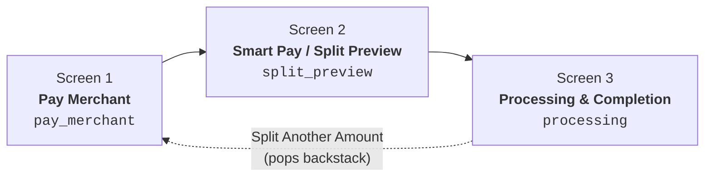

# SplitPay Android — Engineering & Architecture Documentation

SplitPay is an Android UI/UX and engineering prototype showcasing **smart payment splitting** designed to minimize Merchant Discount Rate (MDR) charges for payments above ₹2,000. Under prevailing regulations, single UPI transactions above ₹2,000 may incur MDR fees; SplitPay intelligently decomposes any transaction exceeding ₹1,999 into sequential sub-transaction chunks of up to ₹1,999 each.

> [!IMPORTANT]
> **Prototype Disclaimer:**
> SplitPay is strictly a UI/UX and engineering simulation prototype. It does not integrate with any real banking APIs, UPI SDKs, payment gateways, backend servers, or databases. No real financial transactions or money movement take place.

---

## Technical Stack

- **Language:** Kotlin 2.2.10
- **UI Toolkit:** Jetpack Compose with Material 3 (Compose BOM 2026.02.01)
- **Design System:** Kinetic Ledger (from the Stitch design project *"SplitPay Smart Payment Splitter"*)
- **Architecture:** Clean MVVM (Model-View-ViewModel) + StateFlow
- **Dependency Injection:** Dagger Hilt 2.55
- **Asynchronous Execution:** Kotlin Coroutines (`viewModelScope`, `MutableStateFlow`)
- **Navigation:** Jetpack Navigation Compose 2.8.8
- **Unit Testing:** JUnit 4 + `kotlinx-coroutines-test` 1.10.1

---

## Application Structure (3 Screens)

The application enforces a strict, focused architecture consisting of **exactly three navigation destinations**:



1. **Pay Merchant (`pay_merchant`):** Entry screen displaying merchant profile, editable transaction amount input, Smart Pay toggle, and MDR fee advisory card.
2. **Smart Pay / Split Preview (`split_preview`):** Visual order summary and calculated split breakdown displaying each chunk amount (all $\le$ ₹1,999).
3. **Processing & Completion (`processing`):** Dark radar visualization header and live transaction list tracking sequential simulated settlement chunk-by-chunk. **Payment completion is an in-place state transition of this screen, NOT a separate screen or fourth destination.**

---

## Documentation Index

Explore the detailed architecture and technical specifications in the `doc/` directory:

| Document | Description |
| :--- | :--- |
| [**App Flow (`doc/APP_FLOW.md`)**](APP_FLOW.md) | Comprehensive step-by-step user journey, event triggers, navigation state table, and Mermaid flowcharts. |
| [**Architecture (`doc/ARCHITECTURE.md`)**](ARCHITECTURE.md) | Package structure, clean MVVM layers, Dagger Hilt DI, unidirectional data flow (UDF), and class responsibilities. |
| [**Business Logic (`doc/BUSINESS_LOGIC.md`)**](BUSINESS_LOGIC.md) | Mathematical chunk splitting rules ($\le$ ₹1,999), `Long` precision safety, validation rules, Indian numbering formatting, and edge cases. |
| [**State & Simulation (`doc/STATE_AND_SIMULATION.md`)**](STATE_AND_SIMULATION.md) | `SplitPayUiState`, `PaymentChunk`, `ChunkStatus` lifecycle, sequential coroutine execution, duplicate prevention, and timestamps. |
| [**Testing & QA (`doc/TESTING.md`)**](TESTING.md) | Automated unit tests (20 passed), Compose Previews, build verification commands, and end-to-end verification checklist. |

---

## Build and Run Instructions

### Prerequisites
- Android Studio Ladybug / Meerkat (or newer)
- Android SDK with `compileSdk 37`
- JDK 17 or JDK 21 (configured as `JAVA_HOME`)

### Running Unit Tests
Execute the automated test suite (20 unit tests covering UseCases, ViewModels, and Formatters):
```powershell
.\gradlew.bat testDebugUnitTest
```

### Assembling Debug APK
Build the standalone debug APK:
```powershell
.\gradlew.bat assembleDebug
```
Output artifact generated at:
```text
app/build/outputs/apk/debug/app-debug.apk
```
