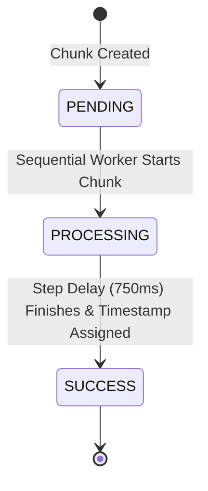

# SplitPay Android — State Model & Sequential Simulation Engine

This document details the reactive state structures, `ChunkStatus` lifecycle transitions, and the sequential coroutine-driven payment simulation engine that drives Screen 3.

---

## State Data Models

### 1. `PaymentChunk`
Represents an individual sub-transaction unit:

```kotlin
data class PaymentChunk(
    val index: Int,             // 1-based sequential index (e.g. 1 of 6)
    val amount: Long,           // Positive amount in whole rupees (always <= 1,999)
    val status: ChunkStatus,    // Current execution state (PENDING, PROCESSING, SUCCESS)
    val timestamp: String? = null // Human-readable completion time (e.g. "9:41 AM")
)
```

### 2. `ChunkStatus` (Lifecycle Enum)
Defines the three valid states for each payment chunk:



- **`PENDING`**: Initial state upon split calculation. The chunk is queued. `timestamp` is `null`.
- **`PROCESSING`**: Active state. Rendered with an animated green spinner. Only **one** chunk can be in this state at any time. `timestamp` is `null`.
- **`SUCCESS`**: Final completed state. Rendered with an emerald checkmark, formatted completion time, and `"PAID"` badge. Once set, it never regresses back to `PENDING` or `PROCESSING` during the run.

### 3. `SplitPayUiState`
Root immutable state object observed by all Compose screens:

```kotlin
data class SplitPayUiState(
    val merchantInfo: MerchantInfo = MerchantInfo(),
    val rawAmountInput: String = "10000",
    val parsedAmount: Long = 10_000L,
    val isSmartPayEnabled: Boolean = true,
    val calculatedChunks: List<PaymentChunk> = emptyList(),
    val isProcessingActive: Boolean = false,
    val isPaymentCompleted: Boolean = false,
    val currentProcessingIndex: Int = -1,
    val errorMessage: String? = null
)
```

---

## Simulation Sequence Diagram

```mermaid
sequenceDiagram
    autonumber
    actor User
    participant Preview as SplitPreviewScreen
    participant VM as SplitPayViewModel
    participant Coroutine as Simulation Coroutine
    participant Screen3 as ProcessingScreen

    User->>Preview: Taps "Confirm & Pay"
    Preview->>Screen3: Navigates to Screen 3
    Screen3->>VM: Calls startPaymentSimulation()
    VM->>VM: Check Guard (isProcessingActive || isPaymentCompleted)
    VM->>VM: Chunk 0 marked PROCESSING; Chunks 1..N marked PENDING
    VM->>Screen3: StateFlow emits initial active state
    Screen3->>User: Displays radar sweep + Chunk 1 spinning

    loop For each chunk index i in 0..chunks.lastIndex
        VM->>Coroutine: Launches step delay (750ms)
        Coroutine-->>VM: Delay completed
        VM->>VM: Chunk i marked SUCCESS with timestamp ("h:mm a")
        alt Next chunk (i + 1) exists
            VM->>VM: Chunk (i + 1) marked PROCESSING
            VM->>Screen3: StateFlow emits updated chunk statuses
            Screen3->>User: Chunk i shows checkmark; Chunk i+1 spins
        else All chunks completed
            VM->>VM: isProcessingActive = false, isPaymentCompleted = true
            VM->>Screen3: StateFlow emits complete state
            Screen3->>User: Shows completion banner, green checkmark radar, "Split Another Amount"
        end
    end

    User->>Screen3: Taps "Split Another Amount"
    Screen3->>VM: resetFlow()
    VM->>Coroutine: Cancels simulationJob
    VM->>VM: Resets state to default 10,000 / 6 PENDING chunks
    Screen3->>User: Pops backstack to PayMerchantScreen (Screen 1)
```

---

## Step-by-Step State Evolution (₹10,000 Example)

Below is the concrete state progression table across a standard 6-chunk payment simulation:

| Step / Timeline | Current Index | Active Status | Completed Count | Progress % | Chunk 1 | Chunk 2 | Chunk 3 | Chunk 4 | Chunk 5 | Chunk 6 | UI Presentation |
|:---|:---:|:---:|:---:|:---:|:---:|:---:|:---:|:---:|:---:|:---:|:---|
| **0. Initial** | -1 | False | 0 / 6 | 0% | PENDING | PENDING | PENDING | PENDING | PENDING | PENDING | Screen 2 (Split Preview) |
| **1. Simulation Start** | 0 | True | 0 / 6 | 0% | **PROCESSING** | PENDING | PENDING | PENDING | PENDING | PENDING | Radar rotating, Chunk 1 spinner |
| **2. After 750ms** | 1 | True | 1 / 6 | 16% | **SUCCESS** | **PROCESSING** | PENDING | PENDING | PENDING | PENDING | Chunk 1 Paid, Chunk 2 spinner |
| **3. After 1500ms** | 2 | True | 2 / 6 | 33% | SUCCESS | **SUCCESS** | **PROCESSING** | PENDING | PENDING | PENDING | Chunk 2 Paid, Chunk 3 spinner |
| **4. After 2250ms** | 3 | True | 3 / 6 | 50% | SUCCESS | SUCCESS | **SUCCESS** | **PROCESSING** | PENDING | PENDING | Chunk 3 Paid, Chunk 4 spinner |
| **5. After 3000ms** | 4 | True | 4 / 6 | 66% | SUCCESS | SUCCESS | SUCCESS | **SUCCESS** | **PROCESSING** | PENDING | Chunk 4 Paid, Chunk 5 spinner |
| **6. After 3750ms** | 5 | True | 5 / 6 | 83% | SUCCESS | SUCCESS | SUCCESS | SUCCESS | **SUCCESS** | **PROCESSING** | Chunk 5 Paid, Chunk 6 spinner |
| **7. After 4500ms (Finish)** | 5 | False | 6 / 6 | 100% | SUCCESS | SUCCESS | SUCCESS | SUCCESS | SUCCESS | **SUCCESS** | Completion banner, "Split Another Amount" |

---

## Concurrency & Integrity Protections

### 1. Duplicate Tap Prevention
To ensure duplicate taps on *"Confirm & Pay"* or rapid back-and-forth navigation cannot spawn parallel simulation jobs, `startPaymentSimulation()` enforces an upfront state guard:
```kotlin
if (_uiState.value.isProcessingActive || _uiState.value.isPaymentCompleted) {
    return
}
```
Any redundant invocation during active execution or after completion is discarded immediately.

### 2. Single-Active Chunk Guarantee
At any point in time during simulation:
$$\text{count}(\text{status} == \text{PROCESSING}) \le 1$$
When chunk $i$ transitions to `SUCCESS`, chunk $i+1$ transitions to `PROCESSING` within the exact same atomic `_uiState.update { ... }` block, eliminating transient states where multiple chunks spin concurrently.

### 3. Safe Cancellation & Reset
The simulation job is stored as a nullable coroutine handle:
```kotlin
private var simulationJob: Job? = null
```
When `resetFlow()` is called:
1. `simulationJob?.cancel()` immediately stops background coroutine progression.
2. `_uiState` resets to default values (`isProcessingActive = false`, `isPaymentCompleted = false`, `currentProcessingIndex = -1`).
3. Fresh chunks are calculated cleanly, enabling immediate subsequent payment runs.
